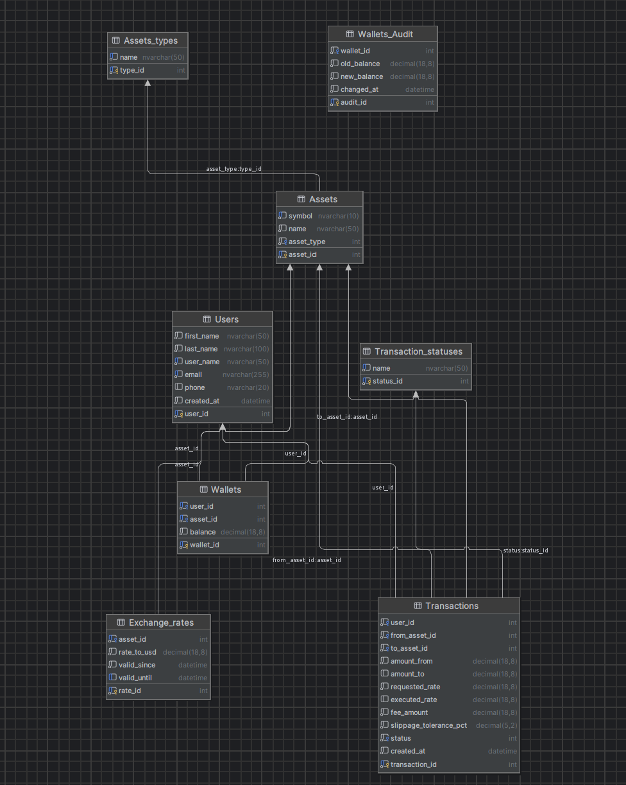

# StockExchange (Antoni Statek, Patryk Ledziński)

Platforma symulująca giełdę akcji i kryptowalut. Projekt wdraża solidną warstwę relacyjnej bazy danych wykorzystującą zaawansowane funkcje T-SQL w celu zapewnienia integralności transakcyjnej (ACID), połączoną z nowoczesnym backendem FastAPI, zautomatyzowanym agregatorem danych rynkowych w czasie rzeczywistym oraz interfejsem webowym..

---

## Schemat Bazy Danych



---

## Architektura Bazy Danych
 

### Tabele
Fundament systemu, przechowujący dane w sposób ściśle zrelacjonowany, z zastosowaniem rygorystycznych ograniczeń (CHECK, UNIQUE).
* **Users** - profile graczy z wbudowaną walidacją formatu e-mail oraz numeru telefonu.
* **Wallets** - portfele użytkowników z bezwzględną blokadą uniemożliwiającą zejście salda poniżej zera.
* **Wallets_Audit** - historyczna księga logów, przechowująca każdy ruch na saldach graczy.
* **Transactions** - księga główna zleceń (zawierająca kwoty, prowizje, żądany kurs i poślizg cenowy).
* **Transaction_statuses** - słownik statusów zleceń (PENDING, COMPLETED, CANCELLED).
* **Assets** oraz **Assets_types** - rejestr obsługiwanych instrumentów finansowych (kryptowaluty, fiat, metale).
* **Exchange_rates** - historia wycen aktywów do dolara, z zachowaniem spójności czasowej (valid_since, valid_until).

### Procedury Składowane 
* **p_CreateTransaction** - Oblicza wyceny  względem USD, nalicza prowizję, weryfikuje poślizg i albo natychmiast realizuje wymianę, albo zapisuje ją do kolejki oczekującej.
* **p_HandlePendingTransaction** - procedura rozliczająca transakcje z kolejki, gdy rynek osiągnie cel cenowy gracza.
* **p_CancelTransaction** - pozwala na bezpieczne wycofanie oczekującego zlecenia i zwraca zablokowane środki.
* **p_AddUser**, **p_UpdateUserDetails**, **p_AddFunds**, **p_DeleteUser** - zestaw procedur administracyjnych do zarządzania cyklem życia użytkownika i jego majątkiem (p_DeleteUser dba o kaskadowe wyczyszczenie całego konta).

### Wyzwalacze (Triggers)
Automatyzują procesy w tle, reagując na zmiany w tabelach bez udziału warstwy API.
* **trg_MatchPendingOrders** - serce silnika dopasowującego. Po wejściu nowych kursów giełdowych iteruje kursorem po oczekujących zleceniach i automatycznie je realizuje, jeśli cena rynkowa spełnia wymagania.
* **trg_AuditWallets** - przechwytuje i bezwarunkowo loguje każdą zmianę salda (update) do tabeli audytowej.
* **trg_AutoCreateWallets** - automatycznie zakłada bazowy portfel USD po poprawnej rejestracji gracza.

### Widoki i Funkcje
Warstwa abstrakcji służąca do bezpiecznego, zoptymalizowanego odczytu danych przez zewnętrzny backend.
* **Widoki:** `v_current_rates`, `v_pending_transactions`, `v_transaction_history`, `v_user_profile`, `v_user_wallets` mapują skomplikowane relacje (JOIN) i agregacje w proste struktury gotowe do pobrania przez API.
* **Funkcje:** `fn_CalculateSlippage` wykonuje na poziomie silnika matematyczne obliczenie odchylenia rynkowego w stosunku do żądanego kursu zlecenia.


### Kod

````
create table Assets_types
(
    type_id int identity
        primary key,
    name    nvarchar(50) not null
        unique
)
go

create table Assets
(
    asset_id   int identity
        primary key,
    symbol     nvarchar(10) not null
        unique,
    name       nvarchar(50) not null,
    asset_type int          not null
        references Assets_types
)
go

create table Exchange_rates
(
    rate_id     int identity
        primary key,
    asset_id    int                        not null
        references Assets,
    rate_to_usd decimal(18, 8)             not null
        constraint chk_rate_positive
            check ([rate_to_usd] > 0),
    valid_since datetime default getdate() not null,
    valid_until datetime,
    constraint uq_asset_id_valid_until
        unique (asset_id, valid_until)
)
go

CREATE trigger trg_MatchPendingOrders
on Exchange_rates
after insert
as
begin
    set nocount on;

    declare @tx_id int;
    declare @from_asset int;
    declare @to_asset int;
    declare @req_rate decimal(18,8);
    declare @from_rate decimal(18,8);
    declare @to_rate decimal(18,8);
    declare @exec_rate decimal(18,8);

    declare order_cursor cursor local fast_forward for
    select transaction_id, from_asset_id, to_asset_id, requested_rate
    from Transactions
    where status = 1;

    open order_cursor;
    fetch next from order_cursor into @tx_id, @from_asset, @to_asset, @req_rate;

    while @@fetch_status = 0
    begin
        select @from_rate = isnull((select rate_to_usd from Exchange_rates where asset_id = @from_asset and valid_until is null), 1.0);
        select @to_rate = isnull((select rate_to_usd from Exchange_rates where asset_id = @to_asset and valid_until is null), 1.0);

        set @exec_rate = @from_rate / @to_rate;

        if @exec_rate >= @req_rate
        begin
            begin try
                exec p_HandlePendingTransaction
                    @transaction_id = @tx_id,
                    @executed_rate = @exec_rate;
            end try
            begin catch
                print 'skipped settlement for transaction id: ' + cast(@tx_id as nvarchar(10));
            end catch
        end

        fetch next from order_cursor into @tx_id, @from_asset, @to_asset, @req_rate;
    end;

    close order_cursor;
    deallocate order_cursor;
end;
go

create table Transaction_statuses
(
    status_id int identity
        primary key,
    name      nvarchar(50) not null
        unique
)
go

create table Users
(
    user_id    int identity
        primary key,
    first_name nvarchar(50)               not null,
    last_name  nvarchar(100)              not null,
    user_name  nvarchar(50)               not null
        unique,
    email      nvarchar(255)              not null
        unique
        constraint chk_users_email_format
            check ([email] like '%_@__%.__%'),
    phone      nvarchar(20)
        constraint chk_users_phone_format
            check (NOT [phone] like '%[^0-9+]%'),
    created_at datetime default getdate() not null,
    constraint chk_users_names_not_empty
        check (len(Trim([first_name])) > 0 AND len(Trim([last_name])) > 0)
)
go

create table Transactions
(
    transaction_id         int identity
        primary key,
    user_id                int                              not null
        references Users,
    from_asset_id          int                              not null
        references Assets,
    to_asset_id            int                              not null
        references Assets,
    amount_from            decimal(18, 8)                   not null,
    amount_to              decimal(18, 8),
    requested_rate         decimal(18, 8)                   not null,
    executed_rate          decimal(18, 8),
    fee_amount             decimal(18, 8) default 0.0       not null
        constraint chk_fee
            check ([fee_amount] >= 0.0),
    slippage_tolerance_pct decimal(5, 2)  default 0.01      not null,
    status                 int                              not null
        references Transaction_statuses,
    created_at             datetime       default getdate() not null,
    constraint chk_amounts
        check ([amount_from] > 0 AND ([amount_to] IS NULL OR [amount_to] > 0)),
    constraint chk_rates
        check ([requested_rate] > 0 AND ([executed_rate] IS NULL OR [executed_rate] > 0))
)
go

CREATE trigger trg_AutoCreateWallets
on Users
after insert
as
begin

    set nocount on;

    insert into Wallets (user_id, asset_id, balance)
    select i.user_id, a.asset_id, 0.0
    from inserted i
    cross join Assets a
    where a.symbol in ('USD');

    print 'created usd wallet for new user.';
end
go

create table Wallets
(
    wallet_id int identity
        primary key,
    user_id   int                        not null
        references Users,
    asset_id  int                        not null
        references Assets,
    balance   decimal(18, 8) default 0.0 not null
        constraint chk_balance_not_negative
            check ([balance] >= 0.0),
    constraint uq_user_asset
        unique (user_id, asset_id)
)
go

CREATE TRIGGER trg_AuditWallets
ON Wallets
AFTER UPDATE
AS
BEGIN
    SET NOCOUNT ON;


    IF UPDATE(balance)
    BEGIN
        INSERT INTO Wallets_Audit (wallet_id, old_balance, new_balance)
        SELECT
            d.wallet_id,
            d.balance,
            i.balance
        FROM deleted d
        JOIN inserted i ON d.wallet_id = i.wallet_id
        WHERE d.balance <> i.balance;
    END
END;
go

create table Wallets_Audit
(
    audit_id    int identity
        primary key,
    wallet_id   int                        not null
        constraint fk_wallets_audit_wallet_id
            references Wallets,
    old_balance decimal(18, 8)             not null,
    new_balance decimal(18, 8)             not null,
    changed_at  datetime default getdate() not null
)
go

-- widok 1: aktualne kursy walut
create view v_current_rates as
select
    a.symbol as asset_symbol,
    a.name as asset_name,
    er.rate_to_usd,
    er.valid_since
from exchange_rates er
join assets a on er.asset_id = a.asset_id
where er.valid_until is null
go

-- widok 2: oczekujące zlecenia giełdowe
create view v_pending_transactions as
select
    af.symbol as from_asset,
    at.symbol as to_asset,
    count(t.transaction_id) as pending_orders_count,
    sum(t.amount_from) as total_locked_volume,
    min(t.requested_rate) as lowest_requested_rate,
    max(t.requested_rate) as highest_requested_rate
from transactions t
join assets af on t.from_asset_id = af.asset_id
join assets at on t.to_asset_id = at.asset_id
where t.status = 1
group by af.symbol, at.symbol
go

-- widok 3: pełna historia transakcji z nazwami statusów
create view v_transaction_history as
select
    t.transaction_id,
    u.user_name,
    af.symbol as from_asset,
    at.symbol as to_asset,
    t.amount_from,
    t.amount_to,
    t.executed_rate,
    s.name as status_name,
    t.created_at
from transactions t
join users u on t.user_id = u.user_id
join assets af on t.from_asset_id = af.asset_id
join assets at on t.to_asset_id = at.asset_id
join transaction_statuses s on t.status = s.status_id
go

create view v_user_profile as
select
    user_name,
    first_name,
    last_name,
    email,
    phone
from users
go

-- widok 4: stany portfeli użytkowników (główny widok dla api)
create view v_user_wallets as
select
    u.user_id,
    u.user_name,
    a.symbol,
    a.name as asset_name,
    w.balance
from wallets w
join users u on w.user_id = u.user_id
join assets a on w.asset_id = a.asset_id
go

CREATE function fn_CalculateSlippage (
    @requested_rate decimal(18,8),
    @actual_rate decimal(18,8)
)
returns decimal(18,8)
as
begin
    return (@requested_rate - @actual_rate) / @requested_rate;
end
go

CREATE procedure p_AddFunds (
    @user_name NVARCHAR(50),
    @asset_symbol NVARCHAR(10),
    @amount DECIMAL(18,8)
)
as
begin
    set nocount on;

    declare @user_id int;
    declare @asset_id int;
    select @user_id = user_id from Users where user_name = @user_name;
    if @user_id is null
        throw 50001, 'error: user not found.', 1;

    select @asset_id = asset_id from Assets where symbol = @asset_symbol;
    if @asset_id is null
        throw 50002, 'error: asset not in database.', 1;

    if @amount <= 0
        throw 50003, 'error: deposit amount must be greater than zero.', 1;

    begin try
        begin tran;
        if exists (
            select 1
            from Wallets with (updlock, holdlock)
            where user_id = @user_id and asset_id = @asset_id
        )
        begin
            update Wallets
            set balance = balance + @amount
            where user_id = @user_id and asset_id = @asset_id;
        end
        else
        begin
            insert into Wallets (user_id, asset_id, balance)
            values (@user_id, @asset_id, @amount);
        end
        commit tran;
        print 'deposit completed successfully!';
    end try
    begin catch
        if @@trancount > 0
            rollback tran;

        print 'transaction failed!';
        throw;
    end catch;
end;
go

CREATE procedure p_AddUser (
    @user_name nvarchar(50),
    @first_name nvarchar(50),
    @last_name nvarchar(50),
    @email nvarchar(100),
    @phone nvarchar(20)
)
as
begin
    set nocount on;

    if exists (select 1 from Users where user_name = @user_name)
        throw 50096, 'error: user with this user_name already exists.', 1;

    begin try
        insert into Users (user_name, first_name, last_name, email, phone)
        values (@user_name, @first_name, @last_name, @email, @phone);

        print 'success: user profile created. usd wallet automatically created.';
    end try
    begin catch
        print 'error: could not create user.';
        throw;
    end catch;
end;
go

CREATE procedure p_CancelTransaction (
    @user_name nvarchar(50),
    @transaction_id int
)
as
begin
    set nocount on;

    declare @user_id int;
    declare @current_status int;
    declare @refund_amount decimal(18,8);
    declare @from_asset_id int;

    select @user_id = user_id from Users where user_name = @user_name;
    if @user_id is null
        throw 50030, 'error: user not found.', 1;

    begin try
        begin tran;

        select
            @current_status = status,
            @refund_amount = amount_from,
            @from_asset_id = from_asset_id
        from Transactions with (updlock)
        where transaction_id = @transaction_id and user_id = @user_id;

        if @current_status is null
            throw 50031, 'error: transaction does not exist or belongs to another user.', 1;

        if @current_status != 1
            throw 50032, 'error: only pending transactions can be cancelled.', 1;

        update Transactions
        set status = 3
        where transaction_id = @transaction_id;
        update Wallets
        set balance = balance + @refund_amount
        where user_id = @user_id and asset_id = @from_asset_id;

        commit tran;
        print 'success: transaction cancelled. funds safely returned to your wallet.';
    end try
    begin catch
        if @@trancount > 0
            rollback tran;

        print 'error: cancellation failed. operation aborted.';
        throw;
    end catch;
end;
go

CREATE procedure p_CreateTransaction (
    @user_name nvarchar(50),
    @from_symbol nvarchar(10),
    @to_symbol nvarchar(10),
    @amount_from decimal(18,8),
    @requested_rate decimal(18,8),
    @slippage_tolerance decimal(5,2) = 0.01
)
as
begin
    set nocount on;

    declare @user_id int;
    declare @from_asset_id int;
    declare @to_asset_id int;
    declare @from_rate decimal(18,8);
    declare @to_rate decimal(18,8);
    declare @executed_rate decimal(18,8);
    declare @amount_to decimal(18,8);
    declare @fee_amount decimal(18,8);
    declare @net_amount_to decimal(18,8);
    declare @current_balance decimal(18,8);
    declare @actual_slippage decimal(18,8);
    declare @target_status int;

    select @user_id = user_id from Users where user_name = @user_name;
    if @user_id is null
        throw 50010, 'error: user profile not found.', 1;

    select @from_asset_id = asset_id from Assets where symbol = @from_symbol;
    select @to_asset_id = asset_id from Assets where symbol = @to_symbol;
    if @from_asset_id is null or @to_asset_id is null
        throw 50011, 'error: one or both assets are unsupported.', 1;

    if @amount_from <= 0
        throw 50012, 'error: source amount must be greater than zero.', 1;

    select @from_rate = isnull((select rate_to_usd from Exchange_rates where asset_id = @from_asset_id and valid_until is null), 1.0);
    select @to_rate = isnull((select rate_to_usd from Exchange_rates where asset_id = @to_asset_id and valid_until is null), 1.0);

    set @executed_rate = @from_rate / @to_rate;

    set @actual_slippage = dbo.fn_CalculateSlippage(@requested_rate, @executed_rate);

    if @actual_slippage <= @slippage_tolerance
    begin
        set @target_status = 2;
    end
    else
    begin
        set @target_status = 1;
    end

    begin try
        begin tran;

        select @current_balance = balance
        from Wallets with (updlock)
        where user_id = @user_id and asset_id = @from_asset_id;

        if @current_balance is null or @current_balance < @amount_from
            throw 50014, 'error: insufficient funds to place this order.', 1;

        update Wallets
        set balance = balance - @amount_from
        where user_id = @user_id and asset_id = @from_asset_id;

        if @target_status = 2
        begin
            set @amount_to = @amount_from * @executed_rate;
            set @fee_amount = @amount_to * 0.001;
            set @net_amount_to = @amount_to - @fee_amount;

            if exists (select 1 from Wallets with (updlock, holdlock) where user_id = @user_id and asset_id = @to_asset_id)
            begin
                update Wallets
                set balance = balance + @net_amount_to
                where user_id = @user_id and asset_id = @to_asset_id;
            end
            else
            begin
                insert into Wallets (user_id, asset_id, balance)
                values (@user_id, @to_asset_id, @net_amount_to);
            end

            insert into Transactions (user_id, from_asset_id, to_asset_id, amount_from, amount_to, requested_rate, executed_rate, fee_amount, slippage_tolerance_pct, status)
            values (@user_id, @from_asset_id, @to_asset_id, @amount_from, @amount_to, @requested_rate, @executed_rate, @fee_amount, @slippage_tolerance, 2);

            print 'success: transaction executed and settled immediately.';
        end
        else
        begin
            insert into Transactions (user_id, from_asset_id, to_asset_id, amount_from, amount_to, requested_rate, executed_rate, fee_amount, slippage_tolerance_pct, status)
            values (@user_id, @from_asset_id, @to_asset_id, @amount_from, null, @requested_rate, null, 0.0, @slippage_tolerance, 1);

            print 'notice: market price changed or limit unmet. order registered as pending.';
        end

        commit tran;
    end try
    begin catch
        if @@trancount > 0
            rollback tran;

        print 'critical: transaction execution failed and was rolled back safely.';
        throw;
    end catch;
end;
go

CREATE procedure p_DeleteUser (
    @user_name nvarchar(50)
)
as
begin
    set nocount on;
    declare @user_id int;

    begin try
        begin tran;

        select @user_id = user_id
        from Users with (updlock, holdlock)
        where user_name = @user_name;

        if @user_id is null
            throw 50095, 'error: user profile not found.', 1;

        delete wa
        from Wallets_Audit wa
        join Wallets w on wa.wallet_id = w.wallet_id
        where w.user_id = @user_id;

        delete from Transactions
        where user_id = @user_id;

        delete from Wallets
        where user_id = @user_id;

        delete from Users
        where user_id = @user_id;

        commit tran;
        print 'success: user and all associated assets, transactions, and logs have been completely wiped.';
    end try
    begin catch
        if @@trancount > 0
            rollback tran;

        print 'error: deletion aborted. system state rolled back safely.';
        throw;
    end catch;
end;
go

CREATE procedure p_HandlePendingTransaction (
    @transaction_id int,
    @executed_rate decimal(18,8)
)
as
begin
    set nocount on;
    declare @user_id int;
    declare @from_asset_id int;
    declare @to_asset_id int;
    declare @current_status int;
    declare @amount_from decimal(18,8);
    declare @amount_to decimal(18,8);
    declare @fee_amount decimal(18,8);
    declare @net_amount_to decimal(18,8);

    begin try
        begin tran;
        select
            @user_id = user_id,
            @from_asset_id = from_asset_id,
            @to_asset_id = to_asset_id,
            @amount_from = amount_from,
            @current_status = status
        from Transactions with (updlock)
        where transaction_id = @transaction_id;

        if @current_status is null
            throw 50040, 'error: transaction not found.', 1;

        if @current_status != 1
            throw 50041, 'error: transaction is already settled or cancelled.', 1;

        set @amount_to = @amount_from * @executed_rate;
        set @fee_amount = @amount_to * 0.001;
        set @net_amount_to = @amount_to - @fee_amount;

        if exists (select 1 from Wallets with (updlock, holdlock) where user_id = @user_id and asset_id = @to_asset_id)
        begin
            update Wallets
            set balance = balance + @net_amount_to
            where user_id = @user_id and asset_id = @to_asset_id;
        end
        else
        begin
            insert into Wallets (user_id, asset_id, balance)
            values (@user_id, @to_asset_id, @net_amount_to);
        end

        update Transactions
        set
            status = 2,
            amount_to = @amount_to,
            executed_rate = @executed_rate,
            fee_amount = @fee_amount
        where transaction_id = @transaction_id;

        commit tran;
        print 'success: pending transaction settled and assets distributed.';
    end try
    begin catch
        if @@trancount > 0
            rollback tran;

        print 'error: settlement failed. system rolled back securely.';
        throw;
    end catch;
end;
go

CREATE procedure p_UpdateUserDetails (
    @user_name nvarchar(50),
    @new_email nvarchar(100),
    @new_phone nvarchar(20)
)
as
begin
    set nocount on;

    if @new_email not like '%_@__%.__%'
        throw 50080, 'error: invalid email format.', 1;

    if @new_phone is not null and @new_phone like '%[^0-9+]%'
        throw 50081, 'error: phone number can only contain digits and a plus sign.', 1;

    begin try
        update Users
        set email = @new_email,
            phone = @new_phone
        where user_name = @user_name;
    end try
    begin catch
        if error_number() = 2627
            throw 50082, 'error: this email is already taken by another user.', 1;
        else
            throw;
    end catch;
end;
go
```
---

## Moduły Aplikacji

### API (Backend)
Usługa napisana w języku Python z wykorzystaniem frameworka **FastAPI** oraz biblioteki **PyODBC**.
* Stanowi asynchroniczny, lekki most komunikacyjny pomiędzy bazą danych a klientem.
* Obsługuje proste uwierzytelnianie (nagłówek `X-User-Name`).
* Przechwytuje surowe błędy natywne sterownika SQL Server (tzw. "brudne" wyjątki) i precyzyjnie wycina z nich wygenerowane przez procedury komunikaty tekstowe, dostarczając frontendowi czyste odpowiedzi w formacie JSON.

### Updater (Aktualizator Danych Rynkowych)
Niezależny mikrosekrypt (`rates_updater.py`) działający w pętli czasowej w tle.
* Integruje się z publicznym API Yahoo Finance (`yfinance`).
* Co 5 minut pobiera rzeczywiste wyceny dla zdefiniowanego koszyka aktywów (BTC, ETH, PLN, XAU itp.).
* Przesyła nowe stawki do bazy danych, precyzyjnie zamykając historyczne świece czasowe (valid_until) z wykorzystaniem dokładnego zegara systemowego serwera, co pozwala na pełną archiwizację ruchów cenowych.

### Frontend
Responsywny interfejs użytkownika zrealizowany w architekturze Single Page Application (SPA).
* Zapewnia natychmiastową nawigację między widokami portfela, kursów i historii bez przeładowywania strony.
* Asynchronicznie komunikuje się z API (Fetch API), aktualizując ekrany oraz tabele.
