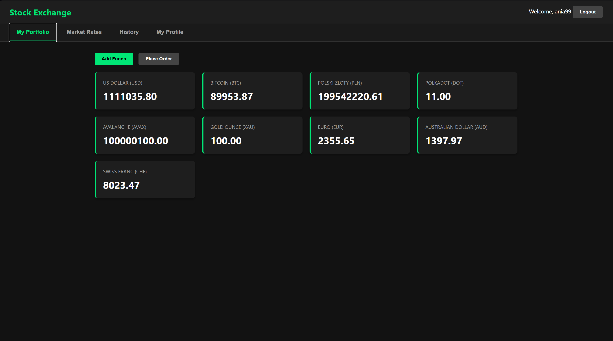
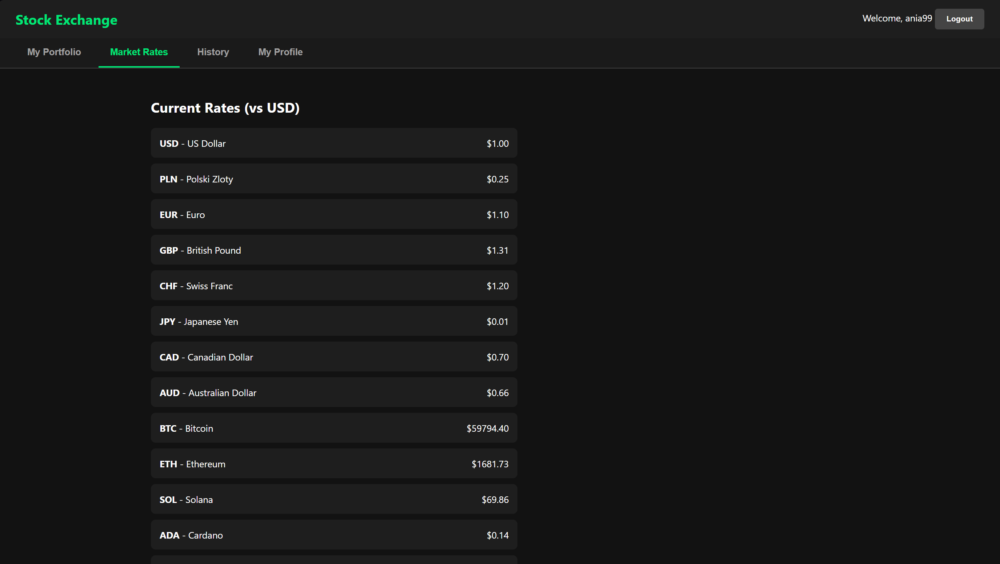
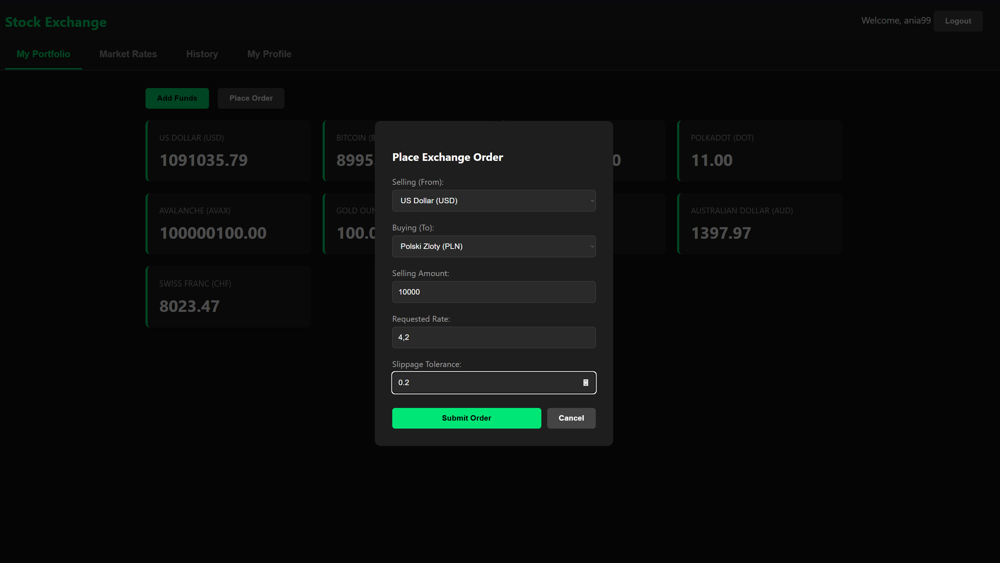
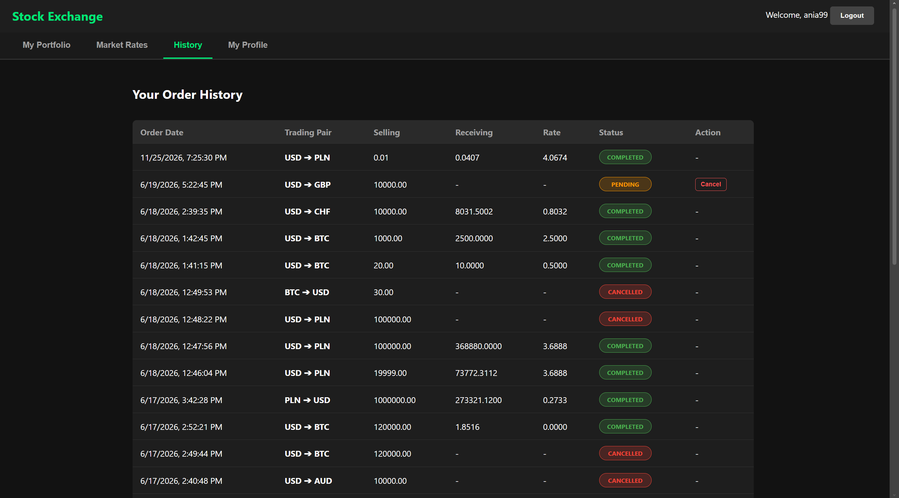
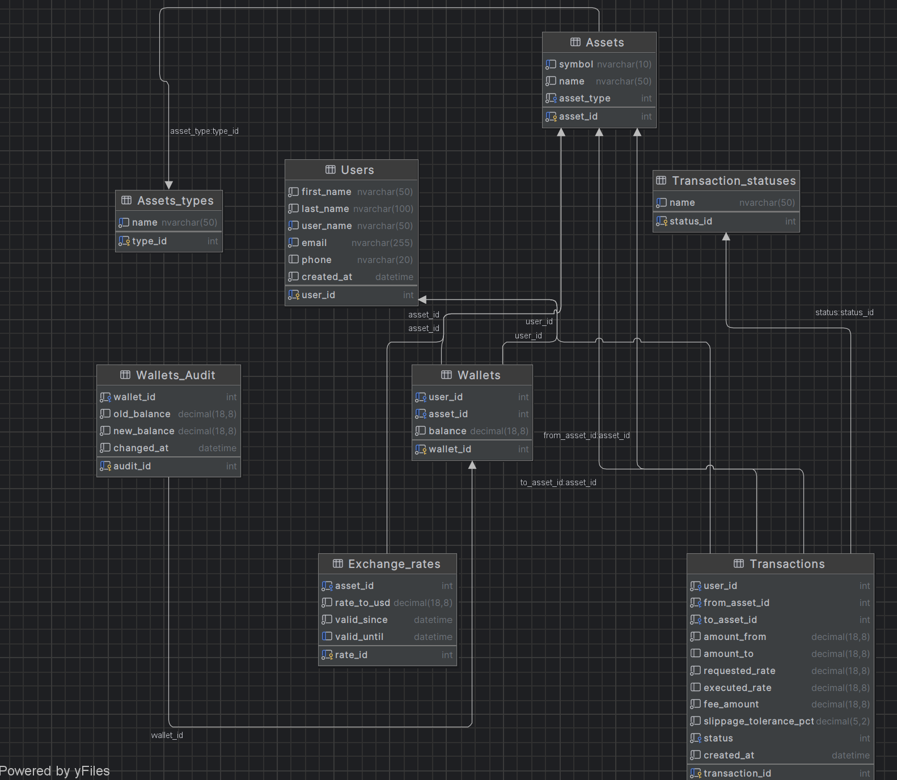

# StockExchange (Antoni Statek, Patryk Ledziński)

> **EN summary:** A stock & crypto exchange simulator. The core of the project is a Microsoft SQL Server database where the trading logic lives in T-SQL: stored procedures create and settle orders (fees, slippage control, pending-order queue), triggers match pending orders automatically whenever new market rates arrive, and every wallet balance change is audited. A FastAPI service exposes the database as a REST API, a Python worker pulls live prices from Yahoo Finance every 5 minutes, and a vanilla JS single-page app serves as the UI.
>
> **Authors:** Antoni Statek – database design and all T-SQL logic, REST API (FastAPI), market data updater. Patryk Ledziński – frontend.

## Quick start

1. Start SQL Server (e.g. the `mcr.microsoft.com/mssql/server` Docker image on port 1433) and create a database named `StockExchange`.
2. Run `DatabaseCode.sql` (schema, procedures, triggers, views), then load the seed data from `Data.sql`.
3. Set the connection settings as environment variables (see `.env.example`), at minimum `DB_PASSWORD`.
4. Install dependencies and run the services:
   ```bash
   pip install -r requirements.txt
   uvicorn StockAPI:app --reload      # API on http://127.0.0.1:8000 (docs: /docs)
   python rates_updater.py            # live price updates every 5 min
   ```
5. Open `frontend/index.html` in a browser and log in with a username from the seed data.

---

Platforma symulująca giełdę akcji i kryptowalut. Projekt wdraża solidną warstwę relacyjnej bazy danych wykorzystującą zaawansowane funkcje T-SQL w celu zapewnienia integralności transakcyjnej (ACID), połączoną z nowoczesnym backendem FastAPI, zautomatyzowanym agregatorem danych rynkowych w czasie rzeczywistym oraz interfejsem webowym..

---

## Screenshots

| Portfolio | Market rates |
|---|---|
|  |  |
| **Placing an order** | **Order history (completed / pending / cancelled)** |
|  |  |

---

## Schemat Bazy Danych



---

## Architektura Bazy Danych
 

### Tabele
Fundament systemu, przechowujący dane w sposób ściśle zrelacjonowany, z zastosowaniem rygorystycznych ograniczeń (CHECK, UNIQUE).
* **Users** - profile graczy z wbudowaną walidacją formatu e-mail oraz numeru telefonu.
* **Wallets** - portfele użytkowników z bezwzględną blokadą uniemożliwiającą zejście salda poniżej zera.
* **Wallets_Audit** - historyczna księga logów, przechowująca każdy ruch na saldach graczy.
* **Transactions** - księga główna zleceń (zawierająca kwoty, prowizje, żądany kurs i poślizg cenowy).
* **Transaction_statuses** - słownik statusów zleceń (PENDING, COMPLETED, CANCELLED).
* **Assets** oraz **Assets_types** - rejestr obsługiwanych instrumentów finansowych (kryptowaluty, fiat, metale).
* **Exchange_rates** - historia wycen aktywów do dolara, z zachowaniem spójności czasowej (valid_since, valid_until).

### Procedury Składowane 
* **p_CreateTransaction** - Oblicza wyceny  względem USD, nalicza prowizję, weryfikuje poślizg i albo natychmiast realizuje wymianę, albo zapisuje ją do kolejki oczekującej.
* **p_HandlePendingTransaction** - procedura rozliczająca transakcje z kolejki, gdy rynek osiągnie cel cenowy gracza.
* **p_CancelTransaction** - pozwala na bezpieczne wycofanie oczekującego zlecenia i zwraca zablokowane środki.
* **p_AddUser**, **p_UpdateUserDetails**, **p_AddFunds**, **p_DeleteUser** - zestaw procedur administracyjnych do zarządzania cyklem życia użytkownika i jego majątkiem (p_DeleteUser dba o kaskadowe wyczyszczenie całego konta).

### Triggery
Automatyzują procesy w tle, reagując na zmiany w tabelach bez udziału warstwy API.
* **trg_MatchPendingOrders** - serce silnika dopasowującego. Po wejściu nowych kursów giełdowych iteruje kursorem po oczekujących zleceniach i automatycznie je realizuje, jeśli cena rynkowa spełnia wymagania.
* **trg_AuditWallets** - przechwytuje i bezwarunkowo loguje każdą zmianę salda (update) do tabeli audytowej.
* **trg_AutoCreateWallets** - automatycznie zakłada bazowy portfel USD po poprawnej rejestracji gracza.

### Widoki i Funkcje
Warstwa abstrakcji służąca do bezpiecznego, zoptymalizowanego odczytu danych przez zewnętrzny backend.
* **Widoki:** `v_current_rates`, `v_pending_transactions`, `v_transaction_history`, `v_user_profile`, `v_user_wallets` mapują skomplikowane relacje (JOIN) i agregacje w proste struktury gotowe do pobrania przez API.
* **Funkcje:** `fn_CalculateSlippage` wykonuje na poziomie silnika matematyczne obliczenie odchylenia rynkowego w stosunku do żądanego kursu zlecenia.


Pełny kod bazy: [`DatabaseCode.sql`](DatabaseCode.sql), dane startowe: [`Data.sql`](Data.sql).

---

## Moduły Aplikacji

### API 
Usługa napisana w języku Python z wykorzystaniem frameworka **FastAPI** oraz biblioteki **PyODBC**.
* Stanowi asynchroniczny, lekki most komunikacyjny pomiędzy bazą danych a klientem.
* Obsługuje proste uwierzytelnianie (nagłówek `X-User-Name`).
* Przechwytuje surowe błędy natywne sterownika SQL Server i precyzyjnie wycina z nich wygenerowane przez procedury komunikaty tekstowe, dostarczając frontendowi czyste odpowiedzi w formacie JSON.

Kod: [`StockAPI.py`](StockAPI.py)

### Updater (Aktualizator Danych Rynkowych)
Niezależny mikrosekrypt (`rates_updater.py`) działający w pętli czasowej w tle.
* Integruje się z publicznym API Yahoo Finance (`yfinance`).
* Co 5 minut pobiera rzeczywiste wyceny dla zdefiniowanego koszyka aktywów (BTC, ETH, PLN, XAU itp.).
* Przesyła nowe stawki do bazy danych, precyzyjnie zamykając historyczne świece czasowe (valid_until) z wykorzystaniem dokładnego zegara systemowego serwera, co pozwala na pełną archiwizację ruchów cenowych.

Kod: [`rates_updater.py`](rates_updater.py)

### Frontend
Responsywny interfejs użytkownika zrealizowany w architekturze Single Page Application (SPA).
* Zapewnia nawigację między widokami portfela, kursów i historii bez przeładowywania strony.
* Asynchronicznie komunikuje się z API (Fetch API), aktualizując ekrany oraz tabele.

Kod: [`frontend/`](frontend/)
