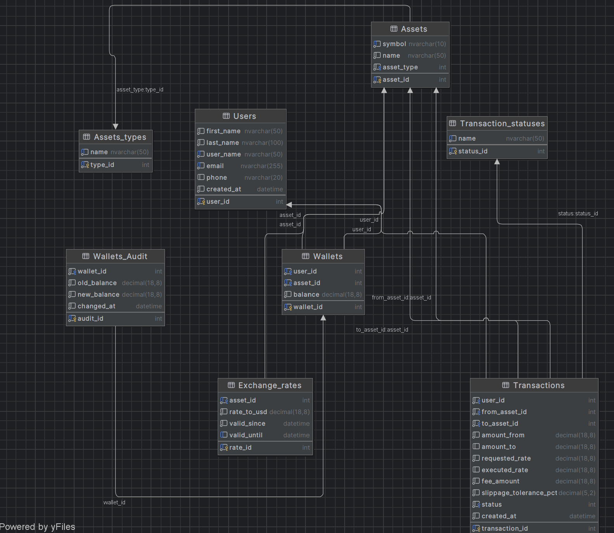

# StockExchange (Antoni Statek, Patryk Ledziński)

Platforma symulująca giełdę akcji i kryptowalut. Projekt wdraża solidną warstwę relacyjnej bazy danych wykorzystującą zaawansowane funkcje T-SQL w celu zapewnienia integralności transakcyjnej (ACID), połączoną z nowoczesnym backendem FastAPI, zautomatyzowanym agregatorem danych rynkowych w czasie rzeczywistym oraz interfejsem webowym..

---

## Schemat Bazy Danych



---

## Architektura Bazy Danych
 

### Tabele
Fundament systemu, przechowujący dane w sposób ściśle zrelacjonowany, z zastosowaniem rygorystycznych ograniczeń (CHECK, UNIQUE).
* **Users** - profile graczy z wbudowaną walidacją formatu e-mail oraz numeru telefonu.
* **Wallets** - portfele użytkowników z bezwzględną blokadą uniemożliwiającą zejście salda poniżej zera.
* **Wallets_Audit** - historyczna księga logów, przechowująca każdy ruch na saldach graczy.
* **Transactions** - księga główna zleceń (zawierająca kwoty, prowizje, żądany kurs i poślizg cenowy).
* **Transaction_statuses** - słownik statusów zleceń (PENDING, COMPLETED, CANCELLED).
* **Assets** oraz **Assets_types** - rejestr obsługiwanych instrumentów finansowych (kryptowaluty, fiat, metale).
* **Exchange_rates** - historia wycen aktywów do dolara, z zachowaniem spójności czasowej (valid_since, valid_until).

### Procedury Składowane 
* **p_CreateTransaction** - Oblicza wyceny  względem USD, nalicza prowizję, weryfikuje poślizg i albo natychmiast realizuje wymianę, albo zapisuje ją do kolejki oczekującej.
* **p_HandlePendingTransaction** - procedura rozliczająca transakcje z kolejki, gdy rynek osiągnie cel cenowy gracza.
* **p_CancelTransaction** - pozwala na bezpieczne wycofanie oczekującego zlecenia i zwraca zablokowane środki.
* **p_AddUser**, **p_UpdateUserDetails**, **p_AddFunds**, **p_DeleteUser** - zestaw procedur administracyjnych do zarządzania cyklem życia użytkownika i jego majątkiem (p_DeleteUser dba o kaskadowe wyczyszczenie całego konta).

### Triggery
Automatyzują procesy w tle, reagując na zmiany w tabelach bez udziału warstwy API.
* **trg_MatchPendingOrders** - serce silnika dopasowującego. Po wejściu nowych kursów giełdowych iteruje kursorem po oczekujących zleceniach i automatycznie je realizuje, jeśli cena rynkowa spełnia wymagania.
* **trg_AuditWallets** - przechwytuje i bezwarunkowo loguje każdą zmianę salda (update) do tabeli audytowej.
* **trg_AutoCreateWallets** - automatycznie zakłada bazowy portfel USD po poprawnej rejestracji gracza.

### Widoki i Funkcje
Warstwa abstrakcji służąca do bezpiecznego, zoptymalizowanego odczytu danych przez zewnętrzny backend.
* **Widoki:** `v_current_rates`, `v_pending_transactions`, `v_transaction_history`, `v_user_profile`, `v_user_wallets` mapują skomplikowane relacje (JOIN) i agregacje w proste struktury gotowe do pobrania przez API.
* **Funkcje:** `fn_CalculateSlippage` wykonuje na poziomie silnika matematyczne obliczenie odchylenia rynkowego w stosunku do żądanego kursu zlecenia.


### Kod

```
create table Assets_types
(
    type_id int identity
        primary key,
    name    nvarchar(50) not null
        unique
)
go

create table Assets
(
    asset_id   int identity
        primary key,
    symbol     nvarchar(10) not null
        unique,
    name       nvarchar(50) not null,
    asset_type int          not null
        references Assets_types
)
go

create table Exchange_rates
(
    rate_id     int identity
        primary key,
    asset_id    int                        not null
        references Assets,
    rate_to_usd decimal(18, 8)             not null
        constraint chk_rate_positive
            check ([rate_to_usd] > 0),
    valid_since datetime default getdate() not null,
    valid_until datetime,
    constraint uq_asset_id_valid_until
        unique (asset_id, valid_until)
)
go

CREATE trigger trg_MatchPendingOrders
on Exchange_rates
after insert
as
begin
    set nocount on;

    declare @tx_id int;
    declare @from_asset int;
    declare @to_asset int;
    declare @req_rate decimal(18,8);
    declare @from_rate decimal(18,8);
    declare @to_rate decimal(18,8);
    declare @exec_rate decimal(18,8);

    declare order_cursor cursor local fast_forward for
    select transaction_id, from_asset_id, to_asset_id, requested_rate
    from Transactions
    where status = 1;

    open order_cursor;
    fetch next from order_cursor into @tx_id, @from_asset, @to_asset, @req_rate;

    while @@fetch_status = 0
    begin
        select @from_rate = isnull((select rate_to_usd from Exchange_rates where asset_id = @from_asset and valid_until is null), 1.0);
        select @to_rate = isnull((select rate_to_usd from Exchange_rates where asset_id = @to_asset and valid_until is null), 1.0);

        set @exec_rate = @from_rate / @to_rate;

        if @exec_rate >= @req_rate
        begin
            begin try
                exec p_HandlePendingTransaction
                    @transaction_id = @tx_id,
                    @executed_rate = @exec_rate;
            end try
            begin catch
                print 'skipped settlement for transaction id: ' + cast(@tx_id as nvarchar(10));
            end catch
        end

        fetch next from order_cursor into @tx_id, @from_asset, @to_asset, @req_rate;
    end;

    close order_cursor;
    deallocate order_cursor;
end;
go

create table Transaction_statuses
(
    status_id int identity
        primary key,
    name      nvarchar(50) not null
        unique
)
go

create table Users
(
    user_id    int identity
        primary key,
    first_name nvarchar(50)               not null,
    last_name  nvarchar(100)              not null,
    user_name  nvarchar(50)               not null
        unique,
    email      nvarchar(255)              not null
        unique
        constraint chk_users_email_format
            check ([email] like '%_@__%.__%'),
    phone      nvarchar(20)
        constraint chk_users_phone_format
            check (NOT [phone] like '%[^0-9+]%'),
    created_at datetime default getdate() not null,
    constraint chk_users_names_not_empty
        check (len(Trim([first_name])) > 0 AND len(Trim([last_name])) > 0)
)
go

create table Transactions
(
    transaction_id         int identity
        primary key,
    user_id                int                              not null
        references Users,
    from_asset_id          int                              not null
        references Assets,
    to_asset_id            int                              not null
        references Assets,
    amount_from            decimal(18, 8)                   not null,
    amount_to              decimal(18, 8),
    requested_rate         decimal(18, 8)                   not null,
    executed_rate          decimal(18, 8),
    fee_amount             decimal(18, 8) default 0.0       not null
        constraint chk_fee
            check ([fee_amount] >= 0.0),
    slippage_tolerance_pct decimal(5, 2)  default 0.01      not null,
    status                 int                              not null
        references Transaction_statuses,
    created_at             datetime       default getdate() not null,
    constraint chk_amounts
        check ([amount_from] > 0 AND ([amount_to] IS NULL OR [amount_to] > 0)),
    constraint chk_rates
        check ([requested_rate] > 0 AND ([executed_rate] IS NULL OR [executed_rate] > 0))
)
go

CREATE trigger trg_AutoCreateWallets
on Users
after insert
as
begin

    set nocount on;

    insert into Wallets (user_id, asset_id, balance)
    select i.user_id, a.asset_id, 0.0
    from inserted i
    cross join Assets a
    where a.symbol in ('USD');

    print 'created usd wallet for new user.';
end
go

create table Wallets
(
    wallet_id int identity
        primary key,
    user_id   int                        not null
        references Users,
    asset_id  int                        not null
        references Assets,
    balance   decimal(18, 8) default 0.0 not null
        constraint chk_balance_not_negative
            check ([balance] >= 0.0),
    constraint uq_user_asset
        unique (user_id, asset_id)
)
go

CREATE TRIGGER trg_AuditWallets
ON Wallets
AFTER UPDATE
AS
BEGIN
    SET NOCOUNT ON;


    IF UPDATE(balance)
    BEGIN
        INSERT INTO Wallets_Audit (wallet_id, old_balance, new_balance)
        SELECT
            d.wallet_id,
            d.balance,
            i.balance
        FROM deleted d
        JOIN inserted i ON d.wallet_id = i.wallet_id
        WHERE d.balance <> i.balance;
    END
END;
go

create table Wallets_Audit
(
    audit_id    int identity
        primary key,
    wallet_id   int                        not null
        constraint fk_wallets_audit_wallet_id
            references Wallets,
    old_balance decimal(18, 8)             not null,
    new_balance decimal(18, 8)             not null,
    changed_at  datetime default getdate() not null
)
go

-- widok 1: aktualne kursy walut
create view v_current_rates as
select
    a.symbol as asset_symbol,
    a.name as asset_name,
    er.rate_to_usd,
    er.valid_since
from exchange_rates er
join assets a on er.asset_id = a.asset_id
where er.valid_until is null
go

-- widok 2: oczekujące zlecenia giełdowe
create view v_pending_transactions as
select
    af.symbol as from_asset,
    at.symbol as to_asset,
    count(t.transaction_id) as pending_orders_count,
    sum(t.amount_from) as total_locked_volume,
    min(t.requested_rate) as lowest_requested_rate,
    max(t.requested_rate) as highest_requested_rate
from transactions t
join assets af on t.from_asset_id = af.asset_id
join assets at on t.to_asset_id = at.asset_id
where t.status = 1
group by af.symbol, at.symbol
go

-- widok 3: pełna historia transakcji z nazwami statusów
create view v_transaction_history as
select
    t.transaction_id,
    u.user_name,
    af.symbol as from_asset,
    at.symbol as to_asset,
    t.amount_from,
    t.amount_to,
    t.executed_rate,
    s.name as status_name,
    t.created_at
from transactions t
join users u on t.user_id = u.user_id
join assets af on t.from_asset_id = af.asset_id
join assets at on t.to_asset_id = at.asset_id
join transaction_statuses s on t.status = s.status_id
go

create view v_user_profile as
select
    user_name,
    first_name,
    last_name,
    email,
    phone
from users
go

-- widok 4: stany portfeli użytkowników (główny widok dla api)
create view v_user_wallets as
select
    u.user_id,
    u.user_name,
    a.symbol,
    a.name as asset_name,
    w.balance
from wallets w
join users u on w.user_id = u.user_id
join assets a on w.asset_id = a.asset_id
go

CREATE function fn_CalculateSlippage (
    @requested_rate decimal(18,8),
    @actual_rate decimal(18,8)
)
returns decimal(18,8)
as
begin
    return (@requested_rate - @actual_rate) / @requested_rate;
end
go

CREATE procedure p_AddFunds (
    @user_name NVARCHAR(50),
    @asset_symbol NVARCHAR(10),
    @amount DECIMAL(18,8)
)
as
begin
    set nocount on;

    declare @user_id int;
    declare @asset_id int;
    select @user_id = user_id from Users where user_name = @user_name;
    if @user_id is null
        throw 50001, 'error: user not found.', 1;

    select @asset_id = asset_id from Assets where symbol = @asset_symbol;
    if @asset_id is null
        throw 50002, 'error: asset not in database.', 1;

    if @amount <= 0
        throw 50003, 'error: deposit amount must be greater than zero.', 1;

    begin try
        begin tran;
        if exists (
            select 1
            from Wallets with (updlock, holdlock)
            where user_id = @user_id and asset_id = @asset_id
        )
        begin
            update Wallets
            set balance = balance + @amount
            where user_id = @user_id and asset_id = @asset_id;
        end
        else
        begin
            insert into Wallets (user_id, asset_id, balance)
            values (@user_id, @asset_id, @amount);
        end
        commit tran;
        print 'deposit completed successfully!';
    end try
    begin catch
        if @@trancount > 0
            rollback tran;

        print 'transaction failed!';
        throw;
    end catch;
end;
go

CREATE procedure p_AddUser (
    @user_name nvarchar(50),
    @first_name nvarchar(50),
    @last_name nvarchar(50),
    @email nvarchar(100),
    @phone nvarchar(20)
)
as
begin
    set nocount on;

    if exists (select 1 from Users where user_name = @user_name)
        throw 50096, 'error: user with this user_name already exists.', 1;

    begin try
        insert into Users (user_name, first_name, last_name, email, phone)
        values (@user_name, @first_name, @last_name, @email, @phone);

        print 'success: user profile created. usd wallet automatically created.';
    end try
    begin catch
        print 'error: could not create user.';
        throw;
    end catch;
end;
go

CREATE procedure p_CancelTransaction (
    @user_name nvarchar(50),
    @transaction_id int
)
as
begin
    set nocount on;

    declare @user_id int;
    declare @current_status int;
    declare @refund_amount decimal(18,8);
    declare @from_asset_id int;

    select @user_id = user_id from Users where user_name = @user_name;
    if @user_id is null
        throw 50030, 'error: user not found.', 1;

    begin try
        begin tran;

        select
            @current_status = status,
            @refund_amount = amount_from,
            @from_asset_id = from_asset_id
        from Transactions with (updlock)
        where transaction_id = @transaction_id and user_id = @user_id;

        if @current_status is null
            throw 50031, 'error: transaction does not exist or belongs to another user.', 1;

        if @current_status != 1
            throw 50032, 'error: only pending transactions can be cancelled.', 1;

        update Transactions
        set status = 3
        where transaction_id = @transaction_id;
        update Wallets
        set balance = balance + @refund_amount
        where user_id = @user_id and asset_id = @from_asset_id;

        commit tran;
        print 'success: transaction cancelled. funds safely returned to your wallet.';
    end try
    begin catch
        if @@trancount > 0
            rollback tran;

        print 'error: cancellation failed. operation aborted.';
        throw;
    end catch;
end;
go

CREATE procedure p_CreateTransaction (
    @user_name nvarchar(50),
    @from_symbol nvarchar(10),
    @to_symbol nvarchar(10),
    @amount_from decimal(18,8),
    @requested_rate decimal(18,8),
    @slippage_tolerance decimal(5,2) = 0.01
)
as
begin
    set nocount on;

    declare @user_id int;
    declare @from_asset_id int;
    declare @to_asset_id int;
    declare @from_rate decimal(18,8);
    declare @to_rate decimal(18,8);
    declare @executed_rate decimal(18,8);
    declare @amount_to decimal(18,8);
    declare @fee_amount decimal(18,8);
    declare @net_amount_to decimal(18,8);
    declare @current_balance decimal(18,8);
    declare @actual_slippage decimal(18,8);
    declare @target_status int;

    select @user_id = user_id from Users where user_name = @user_name;
    if @user_id is null
        throw 50010, 'error: user profile not found.', 1;

    select @from_asset_id = asset_id from Assets where symbol = @from_symbol;
    select @to_asset_id = asset_id from Assets where symbol = @to_symbol;
    if @from_asset_id is null or @to_asset_id is null
        throw 50011, 'error: one or both assets are unsupported.', 1;

    if @amount_from <= 0
        throw 50012, 'error: source amount must be greater than zero.', 1;

    select @from_rate = isnull((select rate_to_usd from Exchange_rates where asset_id = @from_asset_id and valid_until is null), 1.0);
    select @to_rate = isnull((select rate_to_usd from Exchange_rates where asset_id = @to_asset_id and valid_until is null), 1.0);

    set @executed_rate = @from_rate / @to_rate;

    set @actual_slippage = dbo.fn_CalculateSlippage(@requested_rate, @executed_rate);

    if @actual_slippage <= @slippage_tolerance
    begin
        set @target_status = 2;
    end
    else
    begin
        set @target_status = 1;
    end

    begin try
        begin tran;

        select @current_balance = balance
        from Wallets with (updlock)
        where user_id = @user_id and asset_id = @from_asset_id;

        if @current_balance is null or @current_balance < @amount_from
            throw 50014, 'error: insufficient funds to place this order.', 1;

        update Wallets
        set balance = balance - @amount_from
        where user_id = @user_id and asset_id = @from_asset_id;

        if @target_status = 2
        begin
            set @amount_to = @amount_from * @executed_rate;
            set @fee_amount = @amount_to * 0.001;
            set @net_amount_to = @amount_to - @fee_amount;

            if exists (select 1 from Wallets with (updlock, holdlock) where user_id = @user_id and asset_id = @to_asset_id)
            begin
                update Wallets
                set balance = balance + @net_amount_to
                where user_id = @user_id and asset_id = @to_asset_id;
            end
            else
            begin
                insert into Wallets (user_id, asset_id, balance)
                values (@user_id, @to_asset_id, @net_amount_to);
            end

            insert into Transactions (user_id, from_asset_id, to_asset_id, amount_from, amount_to, requested_rate, executed_rate, fee_amount, slippage_tolerance_pct, status)
            values (@user_id, @from_asset_id, @to_asset_id, @amount_from, @amount_to, @requested_rate, @executed_rate, @fee_amount, @slippage_tolerance, 2);

            print 'success: transaction executed and settled immediately.';
        end
        else
        begin
            insert into Transactions (user_id, from_asset_id, to_asset_id, amount_from, amount_to, requested_rate, executed_rate, fee_amount, slippage_tolerance_pct, status)
            values (@user_id, @from_asset_id, @to_asset_id, @amount_from, null, @requested_rate, null, 0.0, @slippage_tolerance, 1);

            print 'notice: market price changed or limit unmet. order registered as pending.';
        end

        commit tran;
    end try
    begin catch
        if @@trancount > 0
            rollback tran;

        print 'critical: transaction execution failed and was rolled back safely.';
        throw;
    end catch;
end;
go

CREATE procedure p_DeleteUser (
    @user_name nvarchar(50)
)
as
begin
    set nocount on;
    declare @user_id int;

    begin try
        begin tran;

        select @user_id = user_id
        from Users with (updlock, holdlock)
        where user_name = @user_name;

        if @user_id is null
            throw 50095, 'error: user profile not found.', 1;

        delete wa
        from Wallets_Audit wa
        join Wallets w on wa.wallet_id = w.wallet_id
        where w.user_id = @user_id;

        delete from Transactions
        where user_id = @user_id;

        delete from Wallets
        where user_id = @user_id;

        delete from Users
        where user_id = @user_id;

        commit tran;
        print 'success: user and all associated assets, transactions, and logs have been completely wiped.';
    end try
    begin catch
        if @@trancount > 0
            rollback tran;

        print 'error: deletion aborted. system state rolled back safely.';
        throw;
    end catch;
end;
go

CREATE procedure p_HandlePendingTransaction (
    @transaction_id int,
    @executed_rate decimal(18,8)
)
as
begin
    set nocount on;
    declare @user_id int;
    declare @from_asset_id int;
    declare @to_asset_id int;
    declare @current_status int;
    declare @amount_from decimal(18,8);
    declare @amount_to decimal(18,8);
    declare @fee_amount decimal(18,8);
    declare @net_amount_to decimal(18,8);

    begin try
        begin tran;
        select
            @user_id = user_id,
            @from_asset_id = from_asset_id,
            @to_asset_id = to_asset_id,
            @amount_from = amount_from,
            @current_status = status
        from Transactions with (updlock)
        where transaction_id = @transaction_id;

        if @current_status is null
            throw 50040, 'error: transaction not found.', 1;

        if @current_status != 1
            throw 50041, 'error: transaction is already settled or cancelled.', 1;

        set @amount_to = @amount_from * @executed_rate;
        set @fee_amount = @amount_to * 0.001;
        set @net_amount_to = @amount_to - @fee_amount;

        if exists (select 1 from Wallets with (updlock, holdlock) where user_id = @user_id and asset_id = @to_asset_id)
        begin
            update Wallets
            set balance = balance + @net_amount_to
            where user_id = @user_id and asset_id = @to_asset_id;
        end
        else
        begin
            insert into Wallets (user_id, asset_id, balance)
            values (@user_id, @to_asset_id, @net_amount_to);
        end

        update Transactions
        set
            status = 2,
            amount_to = @amount_to,
            executed_rate = @executed_rate,
            fee_amount = @fee_amount
        where transaction_id = @transaction_id;

        commit tran;
        print 'success: pending transaction settled and assets distributed.';
    end try
    begin catch
        if @@trancount > 0
            rollback tran;

        print 'error: settlement failed. system rolled back securely.';
        throw;
    end catch;
end;
go

CREATE procedure p_UpdateUserDetails (
    @user_name nvarchar(50),
    @new_email nvarchar(100),
    @new_phone nvarchar(20)
)
as
begin
    set nocount on;

    if @new_email not like '%_@__%.__%'
        throw 50080, 'error: invalid email format.', 1;

    if @new_phone is not null and @new_phone like '%[^0-9+]%'
        throw 50081, 'error: phone number can only contain digits and a plus sign.', 1;

    begin try
        update Users
        set email = @new_email,
            phone = @new_phone
        where user_name = @user_name;
    end try
    begin catch
        if error_number() = 2627
            throw 50082, 'error: this email is already taken by another user.', 1;
        else
            throw;
    end catch;
end;
go
```
---

## Moduły Aplikacji

### API 
Usługa napisana w języku Python z wykorzystaniem frameworka **FastAPI** oraz biblioteki **PyODBC**.
* Stanowi asynchroniczny, lekki most komunikacyjny pomiędzy bazą danych a klientem.
* Obsługuje proste uwierzytelnianie (nagłówek `X-User-Name`).
* Przechwytuje surowe błędy natywne sterownika SQL Server i precyzyjnie wycina z nich wygenerowane przez procedury komunikaty tekstowe, dostarczając frontendowi czyste odpowiedzi w formacie JSON.

#### Kod

```
from fastapi import FastAPI, HTTPException, Security
from fastapi.security import APIKeyHeader
from fastapi.middleware.cors import CORSMiddleware
from pydantic import BaseModel
import pyodbc
from datetime import datetime

app = FastAPI(
    title="StockExchange API",
    description="REST API for the Stock Exchange platform"
)

app.add_middleware(
    CORSMiddleware,
    allow_origins=["*"],
    allow_credentials=True,
    allow_methods=["*"],
    allow_headers=["*"],
)

CONNECTION_STRING = (
    r'DRIVER={ODBC Driver 17 for SQL Server};'
    r'SERVER=localhost,1433;'
    r'DATABASE=StockExchange;'
    r'UID=sa;'
    r'PWD=Prodzekt123;'
    r'TrustServerCertificate=yes;'
)

api_key_header = APIKeyHeader(name="X-User-Name", description="Enter your Username to login", auto_error=True)

class UserCreate(BaseModel):
    user_name: str
    first_name: str
    last_name: str
    email: str
    phone: str

class TransactionCreate(BaseModel):
    from_symbol: str
    to_symbol: str
    amount_from: float
    requested_rate: float
    slippage_tolerance: float = 0.01

class FundWallet(BaseModel):
    asset_symbol: str
    amount: float

class UserUpdate(BaseModel):
    email: str
    phone: str

def get_db_connection():
    return pyodbc.connect(CONNECTION_STRING)

def execute_procedure(query: str, params: tuple, success_response: dict):
    try:
        with get_db_connection() as conn:
            cursor = conn.cursor()
            cursor.execute(query, params)
            conn.commit()
            return success_response
    except pyodbc.Error as e:
        error_str = str(e)
        if '[SQL Server]' in error_str:
            error_msg = error_str.split('[SQL Server]')[1]
            error_msg = error_msg.rsplit('(', 1)[0].strip()
        else:
            error_msg = error_str

        raise HTTPException(status_code=400, detail=error_msg)

def fetch_current_rates():
    try:
        with get_db_connection() as conn:
            cursor = conn.cursor()
            cursor.execute("SELECT asset_symbol, asset_name, rate_to_usd, valid_since FROM v_current_rates")

            rates_list = [{"symbol": row[0], "name": row[1], "rate_to_usd": float(row[2]), "valid_since": str(row[3])} for row in cursor.fetchall()]

            current_time = datetime.now().strftime("%Y-%m-%d %H:%M:%S")
            rates_list.insert(0, {
                "symbol": "usd",
                "name": "US Dollar",
                "rate_to_usd": 1.00,
                "valid_since": current_time
            })

            return {"current_rates": rates_list}
    except Exception as e:
        raise HTTPException(status_code=500, detail=str(e))

@app.get("/admin/rates", tags=["Admin"])
def get_current_rates_admin():
    return fetch_current_rates()

@app.get("/admin/users", tags=["Admin"])
def get_all_users():
    try:
        with get_db_connection() as conn:
            cursor = conn.cursor()
            cursor.execute("SELECT user_name, symbol, balance FROM v_user_wallets")
            users_data = {}
            for row in cursor.fetchall():
                if row.user_name not in users_data:
                    users_data[row.user_name] = {"user_name": row.user_name, "wallets": []}
                users_data[row.user_name]["wallets"].append({"symbol": row.symbol, "balance": float(row.balance)})
            return {"users": list(users_data.values())}
    except Exception as e:
        raise HTTPException(status_code=500, detail=str(e))

@app.post("/admin/users", tags=["Admin"])
def create_new_user(user: UserCreate):
    return execute_procedure(
        "EXEC p_AddUser @user_name=?, @first_name=?, @last_name=?, @email=?, @phone=?",
        (user.user_name, user.first_name, user.last_name, user.email, user.phone),
        {"message": f"User '{user.user_name}' has been successfully created."}
    )

@app.get("/user/rates", tags=["User"])
def get_current_rates_user():
    return fetch_current_rates()

@app.get("/user/portfolio", tags=["User"])
def get_my_portfolio(logged_in_user: str = Security(api_key_header)):
    try:
        with get_db_connection() as conn:
            cursor = conn.cursor()
            cursor.execute("SELECT symbol, asset_name, balance FROM v_user_wallets WHERE user_name = ?", (logged_in_user,))
            wallets = [{"symbol": row[0], "asset_name": row[1], "balance": float(row[2])} for row in cursor.fetchall()]
            if not wallets:
                raise HTTPException(status_code=404, detail="No wallets found. User might not exist or has no funds.")
            return {"user": logged_in_user, "wallets": wallets}
    except pyodbc.Error as e:
         raise HTTPException(status_code=500, detail=str(e))

@app.get("/user/profile", tags=["User"])
def get_my_profile(logged_in_user: str = Security(api_key_header)):
    try:
        with get_db_connection() as conn:
            cursor = conn.cursor()
            cursor.execute("SELECT user_name, first_name, last_name, email, phone FROM v_user_profile WHERE user_name = ?", (logged_in_user,))
            row = cursor.fetchone()

            if not row:
                raise HTTPException(status_code=404, detail="User does not exist!")

            return {
                "user_name": row[0],
                "first_name": row[1],
                "last_name": row[2],
                "email": row[3],
                "phone": row[4]
            }
    except pyodbc.Error as e:
         raise HTTPException(status_code=500, detail=str(e))

@app.get("/user/transactions", tags=["User"])
def get_my_transactions(logged_in_user: str = Security(api_key_header)):
    try:
        with get_db_connection() as conn:
            cursor = conn.cursor()
            cursor.execute("""
                SELECT transaction_id, from_asset, to_asset, amount_from, amount_to, executed_rate, status_name, created_at 
                FROM v_transaction_history 
                WHERE user_name = ?
                ORDER BY created_at DESC
            """, (logged_in_user,))

            transactions_list = []
            for row in cursor.fetchall():
                transactions_list.append({
                    "transaction_id": row[0],
                    "from_asset": row[1].upper(),
                    "to_asset": row[2].upper(),
                    "amount_from": float(row[3]),
                    "amount_to": float(row[4]) if row[4] is not None else None,
                    "executed_rate": float(row[5]) if row[5] is not None else None,
                    "status": row[6],
                    "created_at": str(row[7])
                })

            return {"user": logged_in_user, "transactions": transactions_list}
    except pyodbc.Error as e:
         raise HTTPException(status_code=500, detail=str(e))

@app.put("/user/profile", tags=["User"])
def update_my_profile(profile_data: UserUpdate, logged_in_user: str = Security(api_key_header)):
    return execute_procedure(
        "EXEC p_UpdateUserDetails @user_name=?, @new_email=?, @new_phone=?",
        (logged_in_user, profile_data.email, profile_data.phone),
        {"message": "Your data has been updated."}
    )

@app.post("/user/fund", tags=["User"])
def add_funds(fund_data: FundWallet, logged_in_user: str = Security(api_key_header)):
    return execute_procedure(
        "EXEC p_AddFunds @user_name=?, @asset_symbol=?, @amount=?",
        (logged_in_user, fund_data.asset_symbol, fund_data.amount),
        {
            "message": f"Wallet successfully funded for user '{logged_in_user}'.",
            "details": f"Added {fund_data.amount} {fund_data.asset_symbol.upper()}"
        }
    )

@app.post("/user/trade", tags=["User"])
def create_trade(transaction: TransactionCreate, logged_in_user: str = Security(api_key_header)):
    return execute_procedure(
        """EXEC p_CreateTransaction 
           @user_name=?, @from_symbol=?, @to_symbol=?, 
           @amount_from=?, @requested_rate=?, @slippage_tolerance=?""",
        (logged_in_user, transaction.from_symbol, transaction.to_symbol,
         transaction.amount_from, transaction.requested_rate, transaction.slippage_tolerance),
        {"message": "Order has been successfully submitted to the exchange."}
    )

@app.post("/user/trade/{transaction_id}/cancel", tags=["User"])
def cancel_trade(transaction_id: int, logged_in_user: str = Security(api_key_header)):
    return execute_procedure(
        "EXEC p_CancelTransaction @user_name=?, @transaction_id=?",
        (logged_in_user, transaction_id),
        {"message": "Transaction cancelled. Money returned to wallet"}
    )
```

### Updater (Aktualizator Danych Rynkowych)
Niezależny mikrosekrypt (`rates_updater.py`) działający w pętli czasowej w tle.
* Integruje się z publicznym API Yahoo Finance (`yfinance`).
* Co 5 minut pobiera rzeczywiste wyceny dla zdefiniowanego koszyka aktywów (BTC, ETH, PLN, XAU itp.).
* Przesyła nowe stawki do bazy danych, precyzyjnie zamykając historyczne świece czasowe (valid_until) z wykorzystaniem dokładnego zegara systemowego serwera, co pozwala na pełną archiwizację ruchów cenowych.

#### Kod
```
import time
import pyodbc
import yfinance as yf
import warnings
from datetime import datetime

warnings.filterwarnings('ignore')

CONN_STR = (
    "DRIVER={ODBC Driver 17 for SQL Server};"
    "SERVER=localhost,1433;"
    "DATABASE=StockExchange;"
    "UID=sa;"
    "PWD=Prodzekt123;"
    "TrustServerCertificate=yes;"
)

def fetch_all_prices():
    prices = {}
    mapping = {
        'BTC-USD': 'BTC', 'ETH-USD': 'ETH', 'SOL-USD': 'SOL', 'ADA-USD': 'ADA',
        'XRP-USD': 'XRP', 'DOT-USD': 'DOT', 'DOGE-USD': 'DOGE',
        'LINK-USD': 'LINK', 'AVAX-USD': 'AVAX',
        'PLNUSD=X': 'PLN', 'EURUSD=X': 'EUR', 'GBPUSD=X': 'GBP', 'CHFUSD=X': 'CHF',
        'JPYUSD=X': 'JPY', 'CADUSD=X': 'CAD', 'AUDUSD=X': 'AUD',
        'GC=F': 'XAU',
        'SI=F': 'XAG'
    }

    try:
        tickers_list = list(mapping.keys())
        data = yf.download(tickers_list, period="1d", interval="3m", progress=False)

        for yf_ticker, db_symbol in mapping.items():
            try:
                latest_price = data['Close'][yf_ticker].dropna().iloc[-1]
                prices[db_symbol] = float(latest_price)
            except Exception:
                continue

    except Exception as e:
        print(f"[{datetime.now().strftime('%H:%M:%S')}] API Error: {e}")

    return prices

def update_database(prices):
    if not prices:
        return

    try:
        conn = pyodbc.connect(CONN_STR)
        cursor = conn.cursor()

        local_time = datetime.now().strftime('%Y-%m-%d %H:%M:%S')

        insert_query = """
        DECLARE @asset_id INT;
        SELECT @asset_id = asset_id FROM Assets WHERE symbol = ?;

        IF @asset_id IS NOT NULL
        BEGIN
            UPDATE Exchange_rates
            SET valid_until = ?
            WHERE asset_id = @asset_id AND valid_until IS NULL;

            INSERT INTO Exchange_rates (asset_id, rate_to_usd, valid_since)
            VALUES (@asset_id, ?, ?);
        END
        """

        for symbol, price in prices.items():
            cursor.execute(insert_query, symbol, local_time, price, local_time)

        conn.commit()
        print(f"[{datetime.now().strftime('%H:%M:%S')}] Successfully added {len(prices)} new rows to the database.")

    except pyodbc.Error as e:
        print(f"[{datetime.now().strftime('%H:%M:%S')}] Database Insert Error: {e}")
    finally:
        if 'conn' in locals():
            conn.close()

if __name__ == "__main__":
    print("Press CTRL+C to stop the execution.\n")

    while True:
        try:
            current_prices = fetch_all_prices()
            update_database(current_prices)

        except Exception as e:
            print(f"[{datetime.now().strftime('%H:%M:%S')}] Unexpected error: {e}")

        time.sleep(300)
```

### Frontend
Responsywny interfejs użytkownika zrealizowany w architekturze Single Page Application (SPA).
* Zapewnia nawigację między widokami portfela, kursów i historii bez przeładowywania strony.
* Asynchronicznie komunikuje się z API (Fetch API), aktualizując ekrany oraz tabele.

#### Kod

```
<!DOCTYPE html>
<html lang="en">
<head>
    <meta charset="UTF-8">
    <meta name="viewport" content="width=device-width, initial-scale=1.0">
    <title>Stock Exchange - Player Panel</title>
    <link rel="stylesheet" href="style.css">
</head>
<body>

<div id="login-screen" class="screen">
    <div class="login-box">
        <h2>Exchange Login</h2>
        <input type="text" id="username-input" placeholder="Enter username (e.g., astatek)">
        <button id="login-btn" class="primary-btn">Enter</button>
        <p id="login-error" class="error-msg hidden"></p>
    </div>
</div>

<div id="dashboard-screen" class="screen hidden">
    <header>
        <h1>Stock Exchange</h1>
        <div class="user-controls">
            <span id="welcome-text">Welcome, ...</span>
            <button id="logout-btn" class="secondary-btn">Logout</button>
        </div>
    </header>

    <nav class="tabs-nav">
        <button class="tab-btn active" data-target="portfolio-tab"> My Portfolio</button>
        <button class="tab-btn" data-target="rates-tab"> Market Rates</button>
        <button class="tab-btn" data-target="transactions-tab"> History</button>
        <button class="tab-btn" data-target="profile-tab"> My Profile</button>
    </nav>

    <main>
        <div id="portfolio-tab" class="tab-content">
            <section class="actions-section" style="display: flex; gap: 15px;">
                <button id="open-fund-modal-btn" class="primary-btn"> Add Funds</button>
                <button id="open-trade-modal-btn" class="secondary-btn"> Place Order</button>
            </section>
            <section class="portfolio-section">
                <div id="wallets-container" class="cards-grid"></div>
            </section>
        </div>

        <div id="rates-tab" class="tab-content hidden">
            <section class="rates-section">
                <h2>Current Rates (vs USD)</h2>
                <div id="rates-container" class="rates-list"></div>
            </section>
        </div>

        <div id="transactions-tab" class="tab-content hidden">
            <section class="transactions-section">
                <h2>Your Order History</h2>
                <div class="table-responsive">
                    <table class="transactions-table">
                        <thead>
                        <tr>
                            <th>Order Date</th>
                            <th>Trading Pair</th>
                            <th>Selling</th>
                            <th>Receiving</th>
                            <th>Rate</th>
                            <th>Status</th>
                            <th>Action</th>
                        </tr>
                        </thead>
                        <tbody id="transactions-tbody"></tbody>
                    </table>
                </div>
            </section>
        </div>

        <div id="profile-tab" class="tab-content hidden">
            <section class="profile-section">
                <h2>Account Details</h2>
                <div class="profile-form">
                    <div class="form-group">
                        <label>Login (Nickname):</label>
                        <input type="text" id="profile-username" disabled>
                    </div>
                    <div class="form-group">
                        <label>First Name:</label>
                        <input type="text" id="profile-first-name" disabled>
                    </div>
                    <div class="form-group">
                        <label>Last Name:</label>
                        <input type="text" id="profile-last-name" disabled>
                    </div>
                    <div class="form-group">
                        <label>Email:</label>
                        <input type="email" id="profile-email">
                    </div>
                    <div class="form-group">
                        <label>Phone:</label>
                        <input type="text" id="profile-phone">
                    </div>
                    <button id="update-profile-btn" class="primary-btn">Save Changes</button>
                    <p id="profile-message" class="hidden"></p>
                </div>
            </section>
        </div>
    </main>
</div>

<div id="fund-modal" class="modal hidden">
    <div class="modal-content">
        <h3>Add Funds</h3>
        <div class="form-group">
            <label>Select Asset:</label>
            <select id="asset-select"></select>
        </div>
        <div class="form-group">
            <label>Amount:</label>
            <input type="number" id="amount-input" placeholder="0.00" step="0.01" min="0.01">
        </div>
        <div class="modal-actions">
            <button id="submit-fund-btn" class="primary-btn">Confirm</button>
            <button id="close-modal-btn" class="secondary-btn">Cancel</button>
        </div>
        <p id="modal-error" class="error-msg hidden"></p>
    </div>
</div>

<div id="trade-modal" class="modal hidden">
    <div class="modal-content">
        <h3>Place Exchange Order</h3>
        <div class="form-group">
            <label>Selling (From):</label>
            <select id="trade-from-select"></select>
        </div>
        <div class="form-group">
            <label>Buying (To):</label>
            <select id="trade-to-select"></select>
        </div>
        <div class="form-group">
            <label>Selling Amount:</label>
            <input type="number" id="trade-amount-input" placeholder="0.00" step="0.01" min="0.01">
        </div>
        <div class="form-group">
            <label>Requested Rate:</label>
            <input type="number" id="trade-rate-input" placeholder="0.00" step="0.01" min="0.01">
        </div>
        <div class="form-group">
            <label>Slippage Tolerance:</label>
            <input type="number" id="trade-slippage-input" value="0.01" step="0.01" min="0">
        </div>
        <div class="modal-actions">
            <button id="submit-trade-btn" class="primary-btn">Submit Order</button>
            <button id="close-trade-modal-btn" class="secondary-btn">Cancel</button>
        </div>
        <p id="trade-modal-error" class="error-msg hidden"></p>
        <p id="trade-modal-success" class="success-msg hidden"></p>
    </div>
</div>

<script src="app.js"></script>
</body>
</html>
```

```
:root {
    --bg-color: #121212;
    --panel-bg: #1e1e1e;
    --text-main: #ffffff;
    --text-muted: #a0a0a0;
    --accent-green: #00e676;
    --accent-green-hover: #00c853;
    --error-red: #ff5252;
    --success-green: #4caf50;
}

body {
    margin: 0;
    font-family: 'Segoe UI', Tahoma, sans-serif;
    background-color: var(--bg-color);
    color: var(--text-main);
}

.hidden {
    display: none !important;
}

#login-screen {
    height: 100vh;
    display: flex;
    justify-content: center;
    align-items: center;
}

.login-box {
    background: var(--panel-bg);
    padding: 40px;
    border-radius: 10px;
    text-align: center;
    box-shadow: 0 10px 30px rgba(0,0,0,0.5);
    width: 300px;
}

input, select {
    width: 100%;
    padding: 10px;
    margin: 5px 0 15px;
    box-sizing: border-box;
    background: #2a2a2a;
    border: 1px solid #444;
    color: white;
    border-radius: 5px;
}

button {
    padding: 10px 20px;
    border: none;
    border-radius: 5px;
    cursor: pointer;
    font-weight: bold;
    transition: 0.2s;
}

.primary-btn {
    background-color: var(--accent-green);
    color: #000;
    width: 100%;
}

.primary-btn:hover {
    background-color: var(--accent-green-hover);
}

.secondary-btn {
    background-color: #444;
    color: white;
}

.secondary-btn:hover {
    background-color: #555;
}

header {
    background: var(--panel-bg);
    padding: 15px 30px;
    display: flex;
    justify-content: space-between;
    align-items: center;
}

header h1 {
    margin: 0;
    font-size: 24px;
    color: var(--accent-green);
}

.tabs-nav {
    background: #1a1a1a;
    padding: 0 30px;
    display: flex;
    gap: 10px;
    border-bottom: 2px solid #333;
}

.tab-btn {
    background: transparent;
    color: var(--text-muted);
    border-radius: 0;
    padding: 15px 20px;
    font-size: 16px;
    border-bottom: 3px solid transparent;
    width: auto;
}

.tab-btn:hover {
    color: white;
}

.tab-btn.active {
    color: var(--accent-green);
    border-bottom: 3px solid var(--accent-green);
}

main {
    padding: 30px;
    max-width: 1200px;
    margin: 0 auto;
}

.actions-section {
    margin-bottom: 20px;
}

.actions-section .primary-btn {
    width: auto;
}

.cards-grid {
    display: grid;
    grid-template-columns: repeat(auto-fill, minmax(250px, 1fr));
    gap: 20px;
}

.wallet-card {
    background: var(--panel-bg);
    padding: 20px;
    border-radius: 8px;
    border-left: 4px solid var(--accent-green);
    box-shadow: 0 4px 6px rgba(0,0,0,0.3);
}

.wallet-symbol {
    font-size: 14px;
    color: var(--text-muted);
    text-transform: uppercase;
}

.wallet-balance {
    font-size: 28px;
    font-weight: bold;
    margin-top: 10px;
}

.rate-item {
    background: var(--panel-bg);
    padding: 15px;
    border-radius: 8px;
    margin-bottom: 10px;
    display: flex;
    justify-content: space-between;
    max-width: 600px;
}

.profile-form {
    background: var(--panel-bg);
    padding: 30px;
    border-radius: 8px;
    max-width: 500px;
}

.form-group label {
    font-size: 14px;
    color: var(--text-muted);
}

.modal {
    position: fixed;
    top: 0;
    left: 0;
    width: 100%;
    height: 100%;
    background: rgba(0, 0, 0, 0.7);
    display: flex;
    justify-content: center;
    align-items: center;
}

.modal-content {
    background: var(--panel-bg);
    padding: 30px;
    border-radius: 10px;
    width: 350px;
}

.modal-actions {
    display: flex;
    gap: 10px;
    margin-top: 10px;
}

.error-msg {
    color: var(--error-red);
    font-size: 14px;
    margin-top: 10px;
}

.success-msg {
    color: var(--success-green);
    font-size: 14px;
    margin-top: 10px;
}

.table-responsive {
    overflow-x: auto;
}

.transactions-table {
    width: 100%;
    border-collapse: collapse;
    margin-top: 15px;
    background: var(--panel-bg);
    border-radius: 8px;
    overflow: hidden;
}

.transactions-table th, .transactions-table td {
    padding: 12px 15px;
    text-align: left;
    border-bottom: 1px solid #333;
}

.transactions-table th {
    background-color: #2a2a2a;
    color: var(--text-muted);
    font-weight: bold;
}

.transactions-table tr:hover {
    background-color: #252525;
}

.status-badge {
    padding: 5px 10px;
    border-radius: 20px;
    font-size: 12px;
    font-weight: bold;
    text-transform: uppercase;
    display: inline-block;
    text-align: center;
    min-width: 80px;
}

.status-pending {
    background-color: rgba(255, 152, 0, 0.2);
    color: #ff9800;
    border: 1px solid #ff9800;
}

.status-completed {
    background-color: rgba(76, 175, 80, 0.2);
    color: #4caf50;
    border: 1px solid #4caf50;
}

.status-cancelled {
    background-color: rgba(244, 67, 54, 0.2);
    color: #f44336;
    border: 1px solid #f44336;
}

.cancel-btn {
    background-color: transparent;
    color: var(--error-red);
    border: 1px solid var(--error-red);
    padding: 5px 10px;
    font-size: 12px;
}

.cancel-btn:hover {
    background-color: var(--error-red);
    color: white;
}
```

```
const API_URL = 'http://127.0.0.1:8000';
let currentUser = '';
let originalProfileData = { email: '', phone: '' };

const loginScreen = document.getElementById('login-screen');
const dashboardScreen = document.getElementById('dashboard-screen');
const loginInput = document.getElementById('username-input');
const loginBtn = document.getElementById('login-btn');
const loginError = document.getElementById('login-error');
const welcomeText = document.getElementById('welcome-text');

const walletsContainer = document.getElementById('wallets-container');
const ratesContainer = document.getElementById('rates-container');

const profileUsername = document.getElementById('profile-username');
const profileFirstName = document.getElementById('profile-first-name');
const profileLastName = document.getElementById('profile-last-name');
const profileEmail = document.getElementById('profile-email');
const profilePhone = document.getElementById('profile-phone');
const updateProfileBtn = document.getElementById('update-profile-btn');
const profileMessage = document.getElementById('profile-message');

const fundModal = document.getElementById('fund-modal');
const openFundModalBtn = document.getElementById('open-fund-modal-btn');
const closeModalBtn = document.getElementById('close-modal-btn');
const submitFundBtn = document.getElementById('submit-fund-btn');
const assetSelect = document.getElementById('asset-select');
const amountInput = document.getElementById('amount-input');
const modalError = document.getElementById('modal-error');

const tradeModal = document.getElementById('trade-modal');
const openTradeModalBtn = document.getElementById('open-trade-modal-btn');
const closeTradeModalBtn = document.getElementById('close-trade-modal-btn');
const submitTradeBtn = document.getElementById('submit-trade-btn');
const tradeFromSelect = document.getElementById('trade-from-select');
const tradeToSelect = document.getElementById('trade-to-select');
const tradeAmountInput = document.getElementById('trade-amount-input');
const tradeRateInput = document.getElementById('trade-rate-input');
const tradeSlippageInput = document.getElementById('trade-slippage-input');
const tradeModalError = document.getElementById('trade-modal-error');
const tradeModalSuccess = document.getElementById('trade-modal-success');

const transactionsTbody = document.getElementById('transactions-tbody');
const tabBtns = document.querySelectorAll('.tab-btn');
const tabContents = document.querySelectorAll('.tab-content');

async function fetchPortfolio() {
    try {
        const response = await fetch(`${API_URL}/user/portfolio`, { headers: { 'X-User-Name': currentUser } });
        if (!response.ok) throw new Error('No wallets found.');
        const data = await response.json();

        walletsContainer.innerHTML = '';
        data.wallets.forEach(wallet => {
            walletsContainer.innerHTML += `
                <div class="wallet-card">
                    <div class="wallet-symbol">${wallet.asset_name} (${wallet.symbol.toUpperCase()})</div>
                    <div class="wallet-balance">${wallet.balance.toFixed(2)}</div>
                </div>`;
        });
    } catch (error) {
        walletsContainer.innerHTML = `<p class="error-msg">${error.message}</p>`;
    }
}

async function fetchRates() {
    try {
        const response = await fetch(`${API_URL}/user/rates`, { headers: { 'X-User-Name': currentUser } });
        const data = await response.json();

        ratesContainer.innerHTML = '';
        assetSelect.innerHTML = '';
        tradeFromSelect.innerHTML = '';
        tradeToSelect.innerHTML = '';

        data.current_rates.forEach(rate => {
            ratesContainer.innerHTML += `
                <div class="rate-item">
                    <span><strong>${rate.symbol.toUpperCase()}</strong> - ${rate.name}</span>
                    <span>$${rate.rate_to_usd.toFixed(2)}</span>
                </div>`;

            const optionHTML = `<option value="${rate.symbol}">${rate.name} (${rate.symbol.toUpperCase()})</option>`;
            assetSelect.innerHTML += optionHTML;
            tradeFromSelect.innerHTML += optionHTML;
            tradeToSelect.innerHTML += optionHTML;
        });
    } catch (error) {
        ratesContainer.innerHTML = `<p class="error-msg">Failed to load market rates.</p>`;
    }
}

async function fetchTransactions() {
    try {
        const response = await fetch(`${API_URL}/user/transactions`, { headers: { 'X-User-Name': currentUser } });
        if (!response.ok) throw new Error('Error loading transaction history.');
        const data = await response.json();

        transactionsTbody.innerHTML = '';

        if (data.transactions.length === 0) {
            transactionsTbody.innerHTML = `<tr><td colspan="7" style="text-align:center; color: #a0a0a0;">No transaction history found.</td></tr>`;
            return;
        }

        data.transactions.forEach(tx => {
            let statusClass = 'status-pending';
            const statusName = tx.status.toLowerCase();
            let actionHtml = '-';

            if (statusName.includes('complete') || statusName.includes('settle')) {
                statusClass = 'status-completed';
            } else if (statusName.includes('cancel') || statusName.includes('fail') || statusName.includes('reject')) {
                statusClass = 'status-cancelled';
            } else {
                actionHtml = `<button class="cancel-btn" onclick="cancelTransaction(${tx.transaction_id})">Cancel</button>`;
            }

            const dateObj = new Date(tx.created_at);
            const formattedDate = dateObj.toLocaleString('en-US');

            const amountTo = tx.amount_to ? tx.amount_to.toFixed(4) : '-';
            const execRate = tx.executed_rate ? tx.executed_rate.toFixed(4) : '-';

            transactionsTbody.innerHTML += `
                <tr>
                    <td>${formattedDate}</td>
                    <td><strong>${tx.from_asset} ➔ ${tx.to_asset}</strong></td>
                    <td>${tx.amount_from.toFixed(2)}</td>
                    <td>${amountTo}</td>
                    <td>${execRate}</td>
                    <td><span class="status-badge ${statusClass}">${tx.status}</span></td>
                    <td>${actionHtml}</td>
                </tr>
            `;
        });
    } catch (error) {
        transactionsTbody.innerHTML = `<tr><td colspan="7" class="error-msg" style="text-align:center;">${error.message}</td></tr>`;
    }
}

async function cancelTransaction(transactionId) {
    if (!confirm('Are you sure you want to cancel this pending order? Funds will be returned immediately.')) {
        return;
    }

    try {
        const response = await fetch(`${API_URL}/user/trade/${transactionId}/cancel`, {
            method: 'POST',
            headers: { 'X-User-Name': currentUser }
        });

        const data = await response.json();
        if (!response.ok) throw new Error(data.detail);

        alert(data.message);

        await fetchTransactions();
        await fetchPortfolio();

    } catch (error) {
        alert('Failed to cancel order: ' + error.message);
    }
}

function fillProfileForm(data) {
    profileUsername.value = data.user_name;
    profileFirstName.value = data.first_name;
    profileLastName.value = data.last_name;
    profileEmail.value = data.email;
    profilePhone.value = data.phone;

    originalProfileData.email = data.email;
    originalProfileData.phone = data.phone;
}

function showError(element, message) {
    element.textContent = message;
    element.className = 'error-msg';
}

function showMessage(element, message, className) {
    element.textContent = message;
    element.className = className;
    setTimeout(() => { element.classList.add('hidden'); }, 3000);
}

loginBtn.addEventListener('click', async () => {
    const username = loginInput.value.trim();
    if (!username) {
        showError(loginError, 'Enter your username!');
        return;
    }

    try {
        const response = await fetch(`${API_URL}/user/profile`, {
            headers: { 'X-User-Name': username }
        });

        if (!response.ok) {
            throw new Error('User does not exist on the exchange!');
        }

        const profileData = await response.json();
        fillProfileForm(profileData);

        currentUser = username;
        loginScreen.classList.add('hidden');
        dashboardScreen.classList.remove('hidden');
        welcomeText.innerText = `Welcome, ${currentUser}`;
        loginError.classList.add('hidden');

        await fetchRates();
        await fetchPortfolio();
        await fetchTransactions();

    } catch (error) {
        showError(loginError, error.message);
    }
});

document.getElementById('logout-btn').addEventListener('click', () => {
    currentUser = '';
    loginInput.value = '';
    dashboardScreen.classList.add('hidden');
    loginScreen.classList.remove('hidden');
});

tabBtns.forEach(btn => {
    btn.addEventListener('click', () => {
        tabBtns.forEach(b => b.classList.remove('active'));
        tabContents.forEach(tc => tc.classList.add('hidden'));

        btn.classList.add('active');
        const targetId = btn.getAttribute('data-target');
        document.getElementById(targetId).classList.remove('hidden');
    });
});

updateProfileBtn.addEventListener('click', async () => {
    try {
        const response = await fetch(`${API_URL}/user/profile`, {
            method: 'PUT',
            headers: {
                'Content-Type': 'application/json',
                'X-User-Name': currentUser
            },
            body: JSON.stringify({
                email: profileEmail.value,
                phone: profilePhone.value
            })
        });

        const data = await response.json();
        if (!response.ok) throw new Error(data.detail);

        showMessage(profileMessage, data.message, 'success-msg');

        originalProfileData.email = profileEmail.value;
        originalProfileData.phone = profilePhone.value;

    } catch (error) {
        showMessage(profileMessage, error.message, 'error-msg');

        profileEmail.value = originalProfileData.email;
        profilePhone.value = originalProfileData.phone;
    }
});

openFundModalBtn.addEventListener('click', () => {
    fundModal.classList.remove('hidden');
    modalError.classList.add('hidden');
    amountInput.value = '';
});

closeModalBtn.addEventListener('click', () => fundModal.classList.add('hidden'));

submitFundBtn.addEventListener('click', async () => {
    const symbol = assetSelect.value;
    const amount = parseFloat(amountInput.value);

    if (isNaN(amount) || amount <= 0) {
        showError(modalError, 'Please enter a valid amount.');
        return;
    }

    submitFundBtn.disabled = true;
    submitFundBtn.textContent = 'Processing...';

    try {
        const response = await fetch(`${API_URL}/user/fund`, {
            method: 'POST',
            headers: { 'Content-Type': 'application/json', 'X-User-Name': currentUser },
            body: JSON.stringify({ asset_symbol: symbol, amount: amount })
        });

        const data = await response.json();
        if (!response.ok) throw new Error(data.detail);

        fundModal.classList.add('hidden');
        await fetchPortfolio();
    } catch (error) {
        showError(modalError, error.message);
    } finally {
        submitFundBtn.disabled = false;
        submitFundBtn.textContent = 'Confirm Deposit';
    }
});

openTradeModalBtn.addEventListener('click', () => {
    tradeModal.classList.remove('hidden');
    tradeModalError.classList.add('hidden');
    tradeModalSuccess.classList.add('hidden');
    tradeAmountInput.value = '';
    tradeRateInput.value = '';
});

closeTradeModalBtn.addEventListener('click', () => {
    tradeModal.classList.add('hidden');
});

submitTradeBtn.addEventListener('click', async () => {
    const fromSymbol = tradeFromSelect.value;
    const toSymbol = tradeToSelect.value;
    const amount = parseFloat(tradeAmountInput.value);
    const rate = parseFloat(tradeRateInput.value);
    const slippageElem = document.getElementById('trade-slippage-input');
    const slippage = slippageElem ? parseFloat(slippageElem.value) : 0.01;

    if (fromSymbol === toSymbol) {
        showError(tradeModalError, 'Cannot trade the same asset!');
        return;
    }
    if (isNaN(amount) || amount <= 0 || isNaN(rate) || rate <= 0) {
        showError(tradeModalError, 'Amount and rate must be greater than zero.');
        return;
    }

    submitTradeBtn.disabled = true;
    submitTradeBtn.textContent = 'Processing...';

    try {
        const response = await fetch(`${API_URL}/user/trade`, {
            method: 'POST',
            headers: {
                'Content-Type': 'application/json',
                'X-User-Name': currentUser
            },
            body: JSON.stringify({
                from_symbol: fromSymbol,
                to_symbol: toSymbol,
                amount_from: amount,
                requested_rate: rate,
                slippage_tolerance: slippage
            })
        });

        const data = await response.json();
        if (!response.ok) throw new Error(data.detail);

        tradeModalError.classList.add('hidden');
        showMessage(tradeModalSuccess, data.message, 'success-msg');

        await fetchPortfolio();
        await fetchTransactions();

        setTimeout(() => {
            tradeModal.classList.add('hidden');
            tradeModalSuccess.classList.add('hidden');
        }, 2000);

    } catch (error) {
        showError(tradeModalError, error.message);
    } finally {
        submitTradeBtn.disabled = false;
        submitTradeBtn.textContent = 'Submit Order';
    }
});
```
